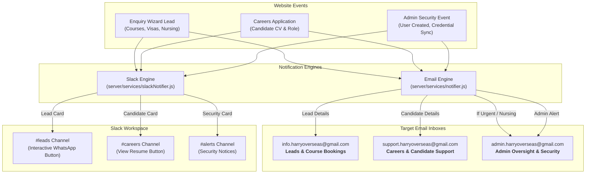

# Harry Overseas — Notifications Setup Guide

Comprehensive setup guide for the automated **Multi-Inbox Email** and **Slack Webhook** notification systems in Harry Overseas (EuroPath).

---

## Architecture Overview

Whenever a client submits an enquiry, a candidate applies for a role, or an administrative event occurs, EuroPath simultaneously dispatches alerts across **Email** and **Slack**:



---

## Multi-Stage Lifecycle Notifications

The system manages dynamic notifications throughout the operational lifecycle of candidates and client enquiries:

### 1. Careers / Job Application Lifecycle
When an admin updates a candidate's status in the Admin Dashboard, the backend triggers both a specialized email to the candidate and an update card to Slack (`#careers`):

| Lifecycle Stage | Candidate Email Notification | Slack Alert (`#careers`) |
| :--- | :--- | :--- |
| **`New`** | `job_applicant_receipt`: Application submission receipt with unique Application ID (`#{{applicationId}}`). | `:briefcase: New Career Application Submitted` with resume link. |
| **`Reviewing`** | Profile logged in recruitment queue. | Internal status sync. |
| **`Shortlisted`** | `candidate_shortlisted`: Congratulations letter, document checklist, and interview preparation guidance. | `:arrows_counterclockwise: Candidate Shortlisted` milestone card. |
| **`Interviewed`** | `candidate_interviewed`: Thank-you note, review period explanation (3-5 business days). | `:arrows_counterclockwise: Interview Completed` card with panel notes. |
| **`Hired`** | `candidate_hired`: Congratulatory formal employment offer, onboarding roadmap, and acceptance link. | `:trophy: Candidate Hired / Offer Extended` card. |
| **`Rejected`** | `candidate_rejected`: Respectful, encouraging update retaining profile in talent pool. | `:heavy_multiplication_x: Candidate Closed` card. |

### 2. Client Enquiry Lifecycle
When an admin updates a client's consultation status in the Admin Dashboard:

| Lifecycle Stage | Client Email Notification | Slack Alert (`#leads`) |
| :--- | :--- | :--- |
| **`New`** | `welcome_lead` / `nurse_pathway_welcome` / `course_enrolment`: Service-specific branded welcome with WhatsApp counselor button. | `:star2: New Client Enquiry Received` with `⚡ [URGENT]` badge if immediate. |
| **`Contacted`** | `enquiry_stage_update`: Informs client that counselor has initiated outreach. | `:arrows_counterclockwise: Client Contacted` milestone card. |
| **`In Progress`** | `enquiry_stage_update`: Document verification, APS prep, or language batch allocation in progress. | `:arrows_counterclockwise: Consultation In Progress` card. |
| **`Closed`** | `enquiry_stage_update`: Case successfully enrolled or concluded. | `:white_check_mark: Lead Concluded / Enrolled` card. |

---

## Part 1: Email Notifications Setup (Gmail SMTP)

The email engine sends branded HTML emails and automated receipts using Gmail's SMTP transport (`smtp.gmail.com:587`).

### Step 1: Generate a Google App Password
Because Google disables plain password access for third-party apps, you must generate a **16-character App Password**:

1. Log into your primary sending Gmail account (e.g. `info.harryoverseas@gmail.com` or `admin.harryoverseas@gmail.com`).
2. Visit **[Google Account Security](https://myaccount.google.com/security)**.
3. Ensure **2-Step Verification** is turned **ON**.
4. In the search bar at the top of your Google Account page, search for **"App Passwords"** (or go to **2-Step Verification &rarr; App Passwords**).
5. Enter an app name, such as `EuroPath`, and click **Create**.
6. Google will display a 16-character password (e.g. `abcd efgh ijkl mnop`). Copy this code (spaces can be omitted).

### Step 2: Configure Environment Variables
Open your `.env` file and set your credentials:

```env
# Multi-Inbox Email Notification Routing
ADMIN_EMAIL=admin.harryoverseas@gmail.com
EMAIL_ADMIN=admin.harryoverseas@gmail.com
EMAIL_INFO=info.harryoverseas@gmail.com
EMAIL_SUPPORT=support.harryoverseas@gmail.com

# SMTP Transport (Primary Sender)
EMAIL_HOST=smtp.gmail.com
EMAIL_PORT=587
EMAIL_USER=info.harryoverseas@gmail.com
EMAIL_PASS=abcdefghijklmnop
```

### Step 3: Verify Email Setup
Run the diagnostic script from your project root:
```bash
node scripts/test-email-notifications.js
```
- If configured properly, you will see `✅ SMTP connection verified successfully`.
- The script will dispatch mock lead and job application test cases to verify internal routing.

---

## Part 2: JSON Email Templates & Personalization

All email layouts are stored as modular JSON data structures in [`server/templates/catalog.json`](server/templates/catalog.json) and compiled dynamically by [`server/services/templateEngine.js`](server/services/templateEngine.js).

### Available Templates
| Template ID | Purpose & Target Recipient | Key Highlights |
| :--- | :--- | :--- |
| `welcome_lead` | Client Welcome & Enquiry Receipt | Personalized greeting (`Willkommen, {{firstName}}!`), consultation summary, WhatsApp button. |
| `course_enrolment` | German Course Booking Confirmation | Course level (`A1`, `A2`, `B1`, or `Combo Offer ₹43,999`), schedule, faculty details. |
| `nurse_pathway_welcome` | Nurse Recruitment Welcome | Details German salary (€2,800–€3,600), Defizitbescheid licensing, document checklist. |
| `job_applicant_receipt` | Candidate Application Receipt | Unique Application ID (`#{{applicationId}}`), applied role, 3-step recruitment timeline. |
| `consultation_booking` | 1-on-1 Consultation Confirmation | Appointment date, time, counselor name, Google Meet video link. |
| `admin_lead_alert` | Internal Lead Alert (`info.harryoverseas@gmail.com`) | Lead contact table, destination, timeline, and direct WhatsApp review link. |
| `support_career_alert` | Internal Careers Alert (`support.harryoverseas@gmail.com`) | Candidate profile, role, and direct resume URL. |
| `admin_security_alert` | Security Notice (`admin.harryoverseas@gmail.com`) | System changes, account creations, credentials sync, actor, and timestamp. |

### Smart Placeholders
Templates support automatic placeholder enrichment:
- `{{firstName}}`: Automatically extracted from `{{fullName}}` (e.g., *"Anjali Thomas"* &rarr; *"Anjali"*).
- `{{whatsappClean}}`: Stripped numeric phone string for `https://wa.me/...` links.
- `{{referenceId}}`, `{{applicationId}}`: Unique tracking codes.
- `{{regularPrice}}` (`₹45,999`), `{{offerPrice}}` (`₹43,999`).
- Fallback syntax: `{{field || Default Value}}` prevents broken brackets.

### Test Email Templates
Verify that all 8 templates compile with zero unresolved tags:
```bash
node scripts/test-email-templates.js
```

### Preview Endpoints in Development
- **List All Templates**: `GET /api/email/templates`
- **Render Live Preview**: `POST /api/email/preview` with JSON:
  ```json
  {
    "templateId": "welcome_lead",
    "data": {
      "fullName": "Rahul Sharma",
      "destinationCountry": "Germany",
      "serviceInterest": "German Language Course"
    }
  }
  ```

---

## Part 3: Slack Notifications Setup (Incoming Webhooks)

Slack notifications use Slack's official **Block Kit** to deliver rich cards with interactive buttons (`💬 WhatsApp Client`, `📄 View Resume`, `✉️ Send Email`).

### Step 1: Create a Slack App
1. Go to **[api.slack.com/apps](https://api.slack.com/apps)**.
2. Click **Create New App** &rarr; select **From scratch**.
3. Name your app (e.g., `EuroPath Notifier`) and select your Slack workspace.

### Step 2: Enable Incoming Webhooks
1. In the left navigation menu, click **Incoming Webhooks**.
2. Toggle the switch to **On**.
3. Scroll down and click **Add New Webhook to Workspace**.
4. Select the channel where you want to receive alerts (e.g., `#leads`, `#careers`, or `#general`) and click **Allow**.
5. Copy the generated **Webhook URL** (starts with `https://hooks.slack.com/services/...`).

### Step 3: Add to `.env`
Add your webhook URL to `.env`:
```env
# Single webhook for all notifications:
SLACK_WEBHOOK_URL=your_slack_incoming_webhook_url_here
```

#### Optional: Channel-Specific Routing
If your workspace uses separate channels for different departments:
```env
# Specific channel overrides:
SLACK_LEADS_WEBHOOK_URL=https://hooks.slack.com/services/...    # Channel: #leads
SLACK_CAREERS_WEBHOOK_URL=https://hooks.slack.com/services/...  # Channel: #careers
SLACK_ALERTS_WEBHOOK_URL=https://hooks.slack.com/services/...   # Channel: #alerts
```

### Step 4: Verify Slack Notifications
Run the Slack test script from your terminal:
```bash
node scripts/test-slack-notifications.js
```
Check your Slack channel — you should see three test cards:
1. `🌟 New Client Enquiry Received` with an interactive WhatsApp button.
2. `💼 New Career Application Submitted` with candidate details.
3. `🛡️ Security Alert: System Diagnostic Completed`.

---

## Part 4: Production Deployment (Vercel)

When deploying to Vercel, configure your environment variables in the Vercel Dashboard:

1. Open your project in **[Vercel Dashboard](https://vercel.com/)**.
2. Go to **Settings &rarr; Environment Variables**.
3. Add the following keys:

| Key | Value | Purpose |
| :--- | :--- | :--- |
| `EMAIL_ADMIN` | `admin.harryoverseas@gmail.com` | Management alerts recipient |
| `EMAIL_INFO` | `info.harryoverseas@gmail.com` | General enquiries recipient |
| `EMAIL_SUPPORT` | `support.harryoverseas@gmail.com` | Careers & support recipient |
| `EMAIL_HOST` | `smtp.gmail.com` | SMTP host |
| `EMAIL_PORT` | `587` | SMTP port |
| `EMAIL_USER` | `info.harryoverseas@gmail.com` | SMTP sending account |
| `EMAIL_PASS` | `(16-char app password)` | Google App Password |
| `SLACK_WEBHOOK_URL` | `https://hooks.slack.com/...` | Slack Incoming Webhook |
| `JWT_SECRET` | `(512-bit hex secret)` | JWT token signing |
| `PAYLOAD_SECRET` | `(256-bit hex secret)` | AES-256 payload decryption |
| `VITE_PAYLOAD_SECRET` | `(same as PAYLOAD_SECRET)` | Client-side payload encryption |

4. Redeploy your project.

---

## Part 5: Troubleshooting & FAQ

### 1. `535-5.7.8 Username and Password not accepted` (Gmail)
- **Cause**: Using standard account password instead of Google App Password, or 2-Step Verification is off.
- **Fix**: Turn ON 2-Step Verification in Google Account &rarr; Security, generate an App Password, and paste the 16 characters into `EMAIL_PASS`.

### 2. `[SECURITY] Failed to decrypt encrypted payload: Unsupported state...`
- **Cause**: `PAYLOAD_SECRET` in the backend does not match `VITE_PAYLOAD_SECRET` on the frontend.
- **Fix**: Ensure both variables are identical in `.env` and restart the server (`npm run server`).

### 3. Slack messages not appearing
- **Cause**: `SLACK_WEBHOOK_URL` is missing or the app was uninstalled from the workspace.
- **Fix**: Run `node scripts/test-slack-notifications.js` to see exact network responses. Ensure the webhook URL begins with `https://hooks.slack.com/services/`.
